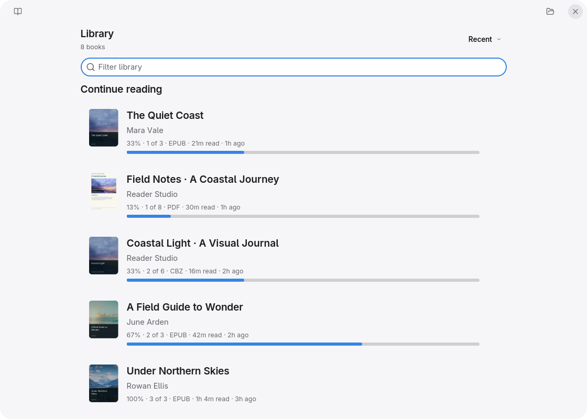
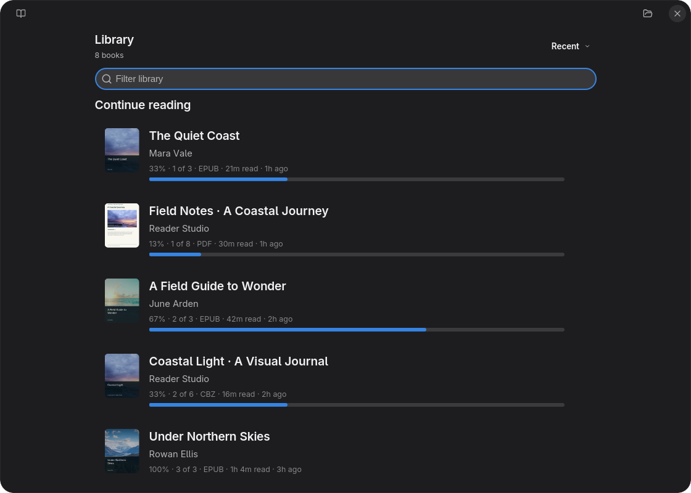
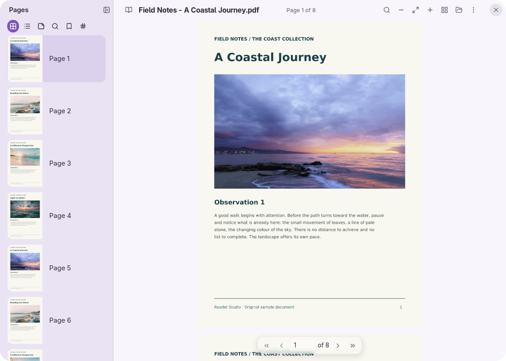
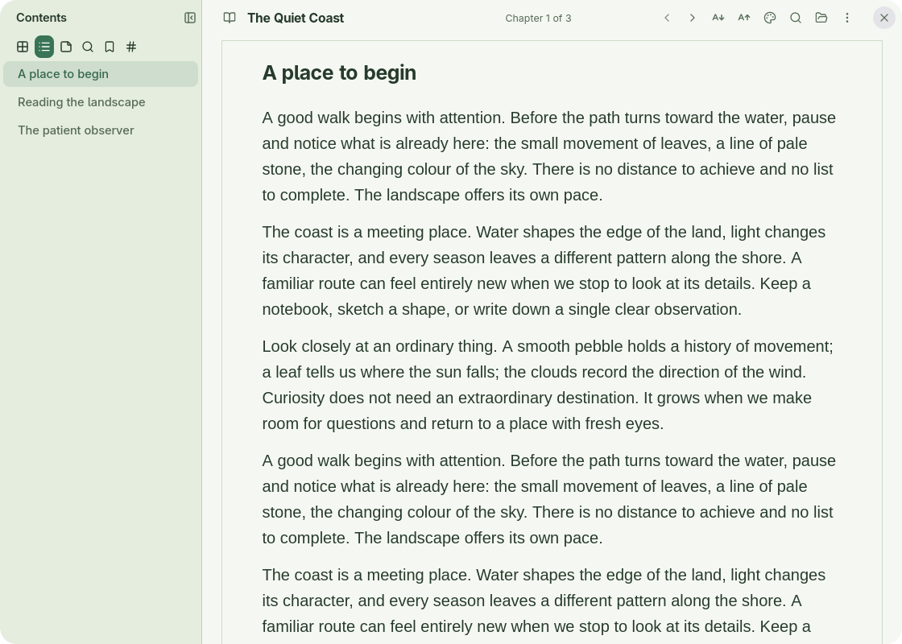
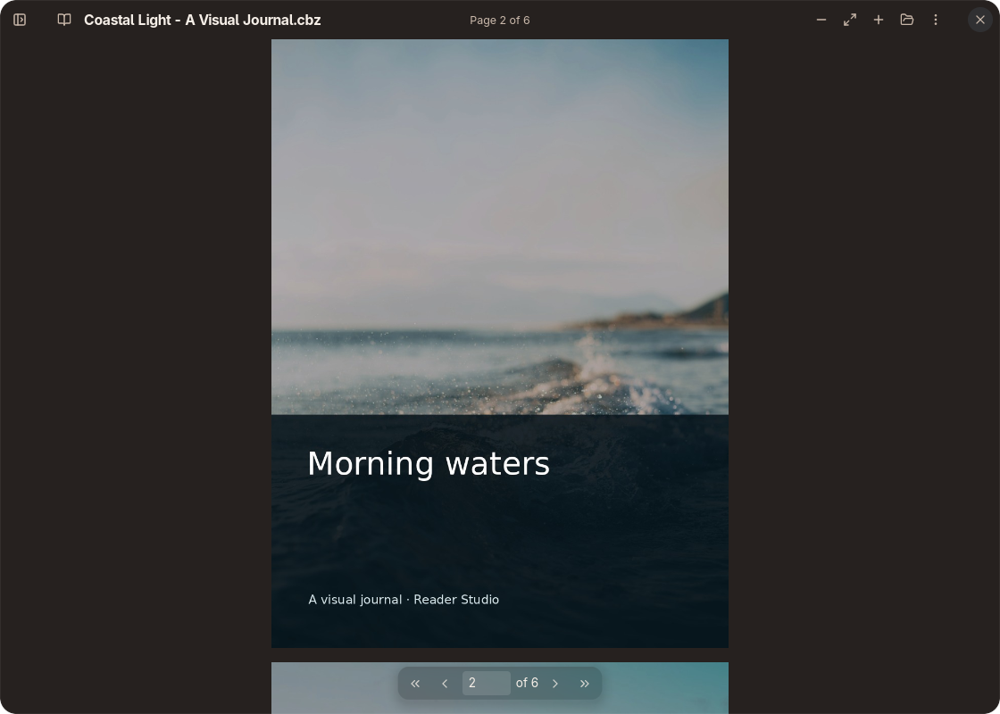
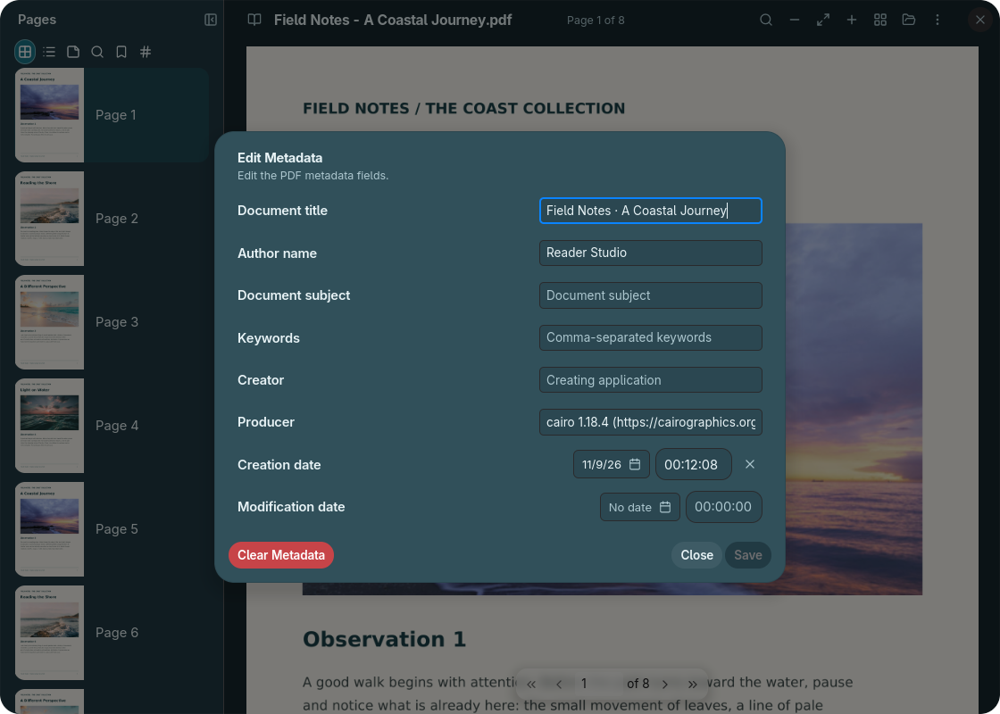
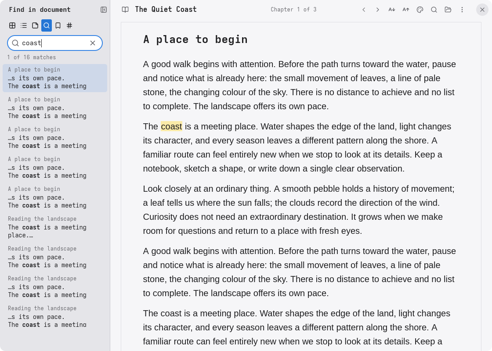
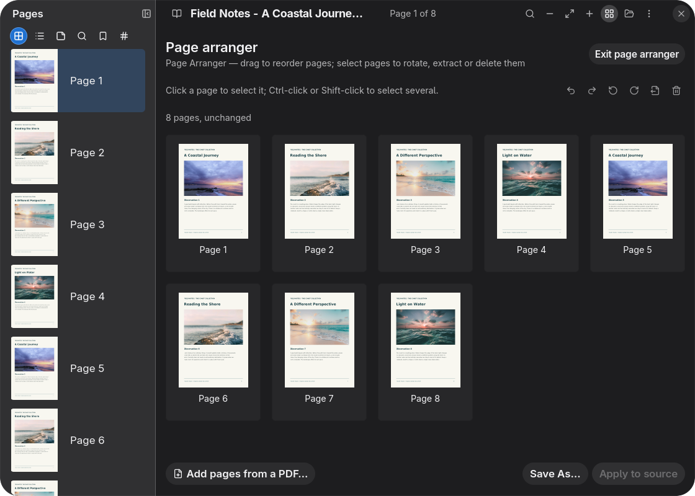

# Reader

A native document reader built with [enzUI](https://github.com/enz1m/enzui).
Read PDF, EPUB and CBZ documents, keep your place, and annotate or edit PDFs
through explicit save operations.

<table>
  <tr>
    <td align="center"><a href="docs/screenshots/basic-light.png"></a><br><sub>Default · Library</sub></td>
    <td align="center"><a href="docs/screenshots/basic-dark.png"></a><br><sub>Dark · Library</sub></td>
    <td align="center"><a href="docs/screenshots/lavender.png"></a><br><sub>Lavender · PDF reading</sub></td>
    <td align="center"><a href="docs/screenshots/sage.png"></a><br><sub>Sage · EPUB reading</sub></td>
  </tr>
  <tr>
    <td align="center"><a href="docs/screenshots/ember.png"></a><br><sub>Ember · Photo journal</sub></td>
    <td align="center"><a href="docs/screenshots/lagoon.png"></a><br><sub>Lagoon · Metadata editor</sub></td>
    <td align="center"><a href="docs/screenshots/precision.png"></a><br><sub>Precision · Search</sub></td>
    <td align="center"><a href="docs/screenshots/comfort.png"></a><br><sub>Comfort · Arrange pages</sub></td>
  </tr>
</table>

Click a screenshot to enlarge. Example documents contain original sample text
and photography from [Unsplash](https://unsplash.com/license).

## Features

- Recent-document library with covers, progress, bookmarks and reading time.
- PDF and CBZ continuous/single/facing-page modes and zoom; PDF page thumbnails.
- EPUB chapters, contents, footnotes, search, adjustable typography and reading palettes.
- PDF text selection, highlights and notes; EPUB character-anchored highlights.
- PDF page arrangement, metadata editing, password tools and typed/image/certificate signatures.
- Native file opening, drag and drop, clipboard text and recent-document sharing.
- Desktop/theme fonts, light and dark themes, and partial German/Arabic translations.

## Build and run

Linux, Rust **1.99.1**, a C compiler, pkg-config, OpenSSL, Poppler-GLib **25.2 or
newer**, Cairo and GLib development libraries are required. The minimum supported
Rust version is **1.95**; the repository selects the development toolchain.

On Arch Linux, native prerequisites include `base-devel pkgconf wayland
libxkbcommon fontconfig openssl poppler-glib cairo glib2`. Use a Vulkan driver
or Mesa software renderer.

```sh
git clone https://github.com/enz1m/reader.git
cd reader
cargo fetch --locked
cargo build --locked
cargo run --locked -- /path/to/document.epub
```

Dependencies use the public [enzUI Alpha 0.1](https://github.com/enz1m/enzui/releases/tag/v0.1.0-alpha.1)
tag and pinned foundation forks. No framework submodule or sibling checkout is
needed. Wayland is the default; enable X11 with `--features x11`. The optional
`center` feature builds the enzUI agent connector; it connects only after enrollment.

## Documents and data

Open a local document through Ctrl+O, a file drop, a command-line path or Linux
“Open With”. Later launches forward to the existing window. The
[desktop entry](assets/io.github.enzui.Reader.desktop) advertises PDF, EPUB and
CBZ; desktop integration installs it and refreshes the applications cache without
changing your default file associations.

Recent documents and reading settings live in
`$XDG_STATE_HOME/reader-app/state.json`. EPUB annotations and bookmarks use
separate document-bound sidecars; PDF annotation and editing operations can
modify the selected PDF. Work on copies when trying editing tools. Save As,
extract and split operations publish separate files with overwrite protection.
Invalid or newer saved state is preserved for explicit recovery.

Ctrl+F opens search, Ctrl+C copies selected text and F1 lists shortcuts. The
interface follows the enzUI theme for `io.github.enzui.Reader`; EPUB reading
palettes can be selected separately. See [format and editing support](docs/FORMAT_SUPPORT.md)
for supported operations and current limits.

## Development

```sh
cargo fmt --all -- --check
ICED_TEST_BACKEND=software cargo test --locked --all-features -- --test-threads=1
cargo clippy --locked --all-targets --all-features -- -D warnings
```

Tests use disposable documents. `ICED_TEST_BACKEND=software` selects the software
renderer for headless interaction checks. No personal library or account is
needed. Keep temporary documents and review artifacts outside version control.

Licensed under [MIT](LICENSE). The interface uses system/theme fonts. The separate
Great Vibes font used by typed signatures retains its [SIL Open Font License](assets/fonts/OFL.txt).
